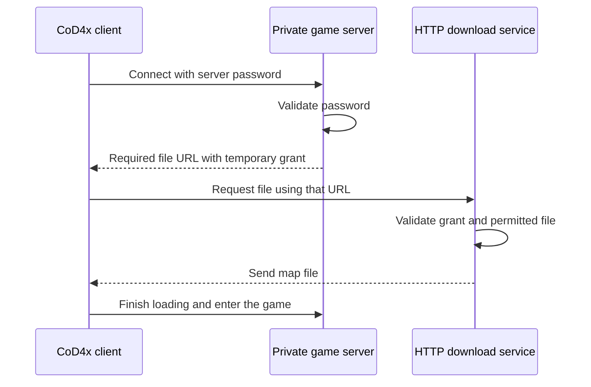

# #203: Map download authorization

Status: proposed design accepted for documentation; implementation and deployment
remain pending. Last updated: 10 November 2026.

Issue: [Prevent unreleased maps from being downloaded (#203)](https://github.com/OpenCJ-dev/server-gsc/issues/203).

## Required behavior

Use the existing OpenCJ database map pool as the public download catalogue.
Do not create a separate released-map catalogue or infer publication from a
map's release date.

| Download access | Allowed map files |
| --- | --- |
| Public/main-server HTTP | Maps in the database map pool, plus the main server's currently active map |
| Private-server HTTP | Files needed for that server's currently active map, after the requesting client supplies the correct server join password |
| Other requests | Denied |

The main-server active-map exception temporarily makes that map publicly
downloadable, even when it is outside the pool. Removing that exception later
cannot recall files already downloaded.

Authorization happens during the initial game connection, **before** map
download/loading. The client is not required to be playing or to possess the
map first. Password validation must be actual validation of the join password,
not an inference from a client slot, reserved-slot access, admin rank, or some
other connection-admission mechanism.

HTTP downloads are intentionally unconfigured in the current deployment.
Saving this proposal does not enable them.

## Proposed architecture

The game server validates the password and issues a temporary download grant.
The HTTP service checks that grant before serving private map bytes. Ordinary
HTTP requests do not automatically carry the result of the game's password
check, so this explicit bridge is necessary.

For private assets, send a short URL containing an unpredictable opaque grant
identifier. The server password must never appear in that URL. A grant maps to
one canonical file and version, the issuing server, the relevant map-load
instance, and an expiry. Changing the requested filename must not grant access
to a different asset.

A server-side integration would issue these URLs only after successful
password validation and only for files required by that private server's
current map. The HTTP gateway would validate the grant and return the original
file bytes. Each game server must authenticate its grant issuance and
active-map updates to the gateway; URL parameters alone are not trusted state.

Public requests can instead use the shared database pool plus trusted
main-server active-map state. Public pool files need not be the currently
active map to be available over HTTP.

All map files may remain in shared storage. The HTTP gateway must be the sole
externally accessible route to private files: there must be no static alias or
origin URL that bypasses authorization. Disabling directory listings, hiding
links, or checking requests only in GSC would not protect guessed URLs.

Native game-protocol fallback must enforce equivalent private authorization,
so a rejected HTTP request cannot obtain the same protected asset through a
different download path. Preserve required mod-file downloads separately from
map membership.

## Transfer lifecycle and limitations

- Use HTTPS for grant confidentiality. Keep URLs short and use URL-safe token
  characters because the existing client/server use bounded URL buffers.
- Permit legitimate retries and byte-range/resume requests. A grant must not
  be consumed by the first HTTP request.
- Recheck authorization for new requests when the active map or password
  authorization changes. Strict revocation needs server-side state; a
  stateless expiring signature alone has a revocation window.
- Define behavior for already-running transfers during a map/password change
  in the implementation. Do not claim immediate revocation of bytes already
  sent.
- An observed-client-IP binding can reduce URL sharing, but cannot distinguish
  different clients behind the same router and must account for legitimate
  networking differences between game and HTTP traffic.
- A URL grant is a bearer credential. Authorized recipients can retain or
  redistribute files they received. This design prevents unauthorized direct
  retrieval; it is not copy protection after authorized delivery.
- Grant lifetime, disconnected-download behavior, refresh/retry handling,
  trusted state freshness and revocation timing need a compatibility prototype.

## CoD4x compatibility evidence

Source inspection supports a server-and-HTTP-service implementation without
requiring a client modification:

1. The server validates the join password during connection handling.
2. `SV_WWWRedirect` sends a complete HTTP URL to an individual client.
3. Client `CL_ParseWWWDownload` retains the intended local filename separately,
   reads the supplied URL and calls `CL_WWWBeginDownload`.
4. `CL_WWWBeginDownload` passes the URL to its HTTP requester and supports
   `Range` requests for resumed downloads.
5. The URL encoder preserves query separators; short opaque tokens can also
   be placed in the path.

This is a source-based feasibility assessment, not a completed client test.
Verify with the deployed CoD4x client before promising compatibility. No
equivalent claim has been tested for an unmodified vanilla CoD4 1.7 client.

Primary sources inspected:

- [CoD4x server connection and redirect code](https://github.com/callofduty4x/CoD4x_Server/blob/master/src/sv_client.c)
- [CoD4x client HTTP download handling](https://github.com/callofduty4x/CoD4x_Client_pub/blob/master/src/cl_main.c#L6762)
- [CoD4x HTTP request implementation](https://github.com/callofduty4x/CoD4x_Client_pub/blob/master/src/httpftp.c)
- Authoritative local server source: `cod4x-server/src/sv_client.c`.
- Current map policy: `server-gsc/opencj/maps.gsc`.

## Shared database pool: original proposal context

At proposal time, the candidate was `openCJ_cod4.mapids.inRotation`, not `releaseDate`.
The voting filter still hard-coded ten names in `alphaMapNames()`.
The database marked 457 maps as in rotation, including the ten alpha maps,
so using that flag first required confirming the intended membership.
This prerequisite has since been applied; see the update below.

## Future validation

After implementation is separately requested, use isolated checks for:

- Public pool files, the main active-map exception and blocked non-pool files.
- Correct versus incorrect/missing private join passwords before downloading.
- Cross-file, cross-server, stale, expired and modified grants.
- Canonical paths, traversal attempts and access through alternate endpoints.
- Map/password changes, retries, range/resume requests and mod dependencies.
- Actual client redirection and equivalent native fallback restrictions.

No source, configuration, database or runtime changes are authorized merely
by storing this design. No HTTP service has been deployed.

## Catalogue prerequisite applied, 10 November 2026
