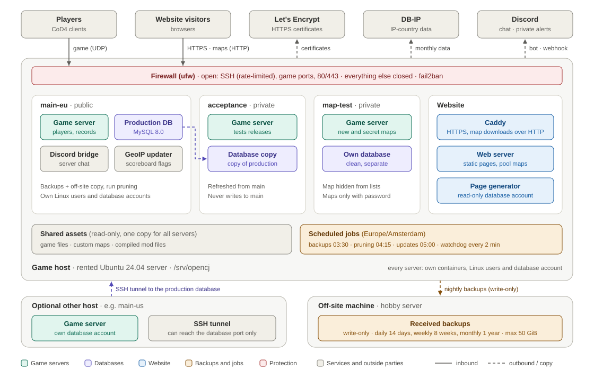

# Running OpenCJ servers: administrator guide

This guide is for the person who looks after OpenCJ servers installed with
`opencj.sh install` ([installation guide](../setup/server.md)). It explains what runs by
itself, what you should check now and then, and how to change things. After the
first installation, every command is available as `sudo opencj <command>`.

## How it fits together



- **Game servers** each run in their own containers, as their own Linux user, with
  their own database account. Players reach them through the firewall on their
  game port. main-eu always runs; acceptance and map-test are **on demand**: off
  until you start them, database included.
- **Databases.** main-eu owns the production database. acceptance has its own
  *copy*, refreshed on request; changes there never reach main. map-test has its own
  clean database. *Planned, switched off until tested:* a server in another country
  sharing main's database through an SSH tunnel that can reach nothing but the
  database port.
- **Shared assets.** One read-only copy of the game files and maps serves every
  server on the machine and the website.
- **Website.** The page generator reads only the tables the website needs, with a
  read-only account. Caddy serves the site over HTTPS (certificates from Let's
  Encrypt) and map downloads for pool maps over plain HTTP, which CoD4 needs.
  Private servers send their maps in game, only to players who joined with the
  password.
- **Discord.** The chat bridge connects one server to a public channel with a bot
  account. Alerts are separate: the scheduled jobs post them to a private channel
  through a webhook.
- **Backups** are made on the machine that owns each database and copied each night
  to the external backup server, which moves them out of the game host's reach.

## First-time setup

The [installation guide](../setup/server.md) explains every option in detail. In short:

**Before you start**

1. Rent a server with **Ubuntu 24.04 LTS (x86-64)**: at least 4 CPU cores, 8 GiB RAM
   and **120 GiB disk** (16 GiB game files and maps, Docker images, backups, and a
   temporary second copy of everything during a migration).
2. Log in as root (a fresh rented server) or as a user that can use `sudo`. As root,
   setup offers to create your **personal administrator account** and switch root
   login off: you type its password into `passwd` (hidden, never stored by setup), it
   can reuse root's SSH key, and root login goes off only after you have logged in as
   that account with your key and run `sudo true` there. Setup always switches SSH
   password logins off. If your **SSH key** is not on the server yet, setup shows how
   to add it and waits until you have logged in with it, so you cannot be locked out.
3. Decide the **names**: the website's main domain (for example `opencj.org`), any
   extra domains that should open the same site (for example `opencj.net`; they
   redirect to the main one), and optionally a name per game server (for example
   `eu.opencj.org`). Setup prints this server's public IP address and the exact DNS
   records to create, checks them, and waits for the website's records before it
   asks for HTTPS certificates. `sudo opencj dns` shows them again later.
4. If your provider has its own firewall, allow SSH, the game ports (UDP and TCP,
   by default 28960-28962) and 80/443.
5. Optional: create the **Discord bot** for the chat bridge and a **webhook** in a
   private channel for alerts. Setup shows the steps with links when it asks; see
   also *Discord* under *Change settings* below.
6. To migrate from the old server: on the new server create a key
   (`sudo ssh-keygen -t ed25519 -f /root/migration-key`), add its `.pub` line to the
   old server account's `~/.ssh/authorized_keys` (an account with `sudo`), and save
   the old server's host key (`ssh-keyscan -p <port> <old host> | sudo tee
   /root/migration-known_hosts`; compare its fingerprint on the old server).

**Install**

```sh
sudo apt-get update && sudo apt-get install -y git
git clone https://github.com/OpenCJ-org/opencj-core.git
cd opencj-core
git checkout <release tag>
sudo bash opencj.sh install
```

The wizard asks which servers to create (suggested: `main-eu,acceptance,map-test`),
then per server: name, game port, the address players connect to, slots, public or
private, whether it stays off until you start it (yes for every server except main),
where its database comes from, map downloads, Discord, backups and pruning;
then for the machine: website and its domains, updates, firewall, SSH hardening and
alerts. It shows a summary and the DNS records to create before it starts.
Building and copying can take an hour. If anything stops, run the same command
again: finished work is kept.

Start with a **rehearsal** migration (the old server keeps running) and look around
on the new servers. When you are ready to move for real, migrate again with
**cutover**, which keeps the old server stopped.

**Right after installing**

1. On the external backup server, run the `backup-receiver` command that setup printed.
2. `sudo opencj alerts` and check that the test message arrives. It also prints a
   `monitor` command: run that on the external backup server too, so you hear about it
   when this whole machine goes down (see *Outside check* below).
3. `sudo opencj status` ends with **Everything OK.** (a new install may list jobs as
   "not run yet" and a certificate that is still being fetched).
4. Join each server in game (private servers: password in
   `/srv/opencj/<server>/join-password`) and open the website over HTTPS. Test
   servers are off after installing: `sudo opencj start acceptance` first (see
   *Test servers on demand*).
5. When main is ready for players: `sudo opencj configure main-eu` and answer
   **yes** to public access.

## What is where

| Path | Contents |
| --- | --- |
| `/srv/opencj/host-setup.json` | The plan for this machine: servers, firewall, SSH, updates, alert channel |
| `/srv/opencj/<server>/` | One folder per server: settings (`installation.json`), generated files, runtime files, backups |
| `/srv/opencj/<server>/join-password`, `rcon-password` | The server's join and administration passwords |
| `/srv/opencj/<server>/automatic-backups/` | Nightly database backups (the newest 7, within 2 GiB) |
| `/srv/opencj/<server>/upgrade-backups/` | Full backups taken before every upgrade and restore |
| `/srv/opencj/assets/` | Game files, maps (`game/usermaps/`) and compiled mod files, shared by all servers |
| `/srv/opencj-offsite/.kept/<server>/` | On the external backup server: received copies of the backups (root only; new uploads arrive in `/srv/opencj-offsite/<server>/` and move here within an hour) |
| `/usr/local/sbin/opencj` | The `opencj` command: a link to `opencj.sh` in the checkout that installed or last upgraded |

Everything under `/srv/opencj` is readable only by root. Never share
`installation.json` or the `secrets/` folders: they contain passwords and keys.

## What happens automatically

| What | When | Where to see the result |
| --- | --- | --- |
| Crashed services start again | Immediately | `opencj status` (crash count), alert |
| Watchdog: restart a hung game server; report crashes, stopped services, low disk | Every 2 minutes | Alerts |
| Database backup, then copy to the external backup server | Nightly 03:30 | `opencj status`, alert on failure |
| Delete unfinished runs not played for 6 months | Nightly 04:15 | `opencj status` (`last-prune.json`) |
| Ubuntu security updates | Daily 05:00 | `journalctl -u apt-daily-upgrade` |
| Reboot, only when an update needs it | 05:30 | Servers start by themselves |
| Housekeeping: old images, caches, old copies | Sundays 04:30 | `journalctl -u opencj-housekeeping` |
| Off-site: secure new uploads, then retention (on the receiver) | Hourly | `journalctl -u opencj-offsite-retention` |
| IP-country data update (scoreboard flags) | Checked daily | `docker logs` of the `geoip` service |
| Outside check (on the external backup server): game servers and website answer | Every 2 minutes | Alerts: DOWN after ~6 minutes, RECOVERED when back |
| Website pages rebuilt, HTTPS certificate renewed | Every minute / by itself | The website |

A test server that is off is left alone: the watchdog does not report it, and its
backup and pruning jobs (if switched on) skip it, since its data cannot change.
All times are Europe/Amsterdam. Failed jobs and watchdog findings are sent to
the alert channel (see below) and always written to the system journal.

## Your routine

**Every day (a glance):** read the alert channel. No messages means nothing went
wrong. A crash alert includes the last log lines; repeated crashes of one server
need investigation (see *When something goes wrong*).

**Every week:**

```sh
sudo opencj status
```

It checks everything on this machine and ends with either **Everything OK.** or a
**Needs attention** list, each line saying what is wrong and where to look:

| Part | What is checked |
| --- | --- |
| Servers | State, health, map, players and crash count of every game server; a test server that is off shows `off (on demand)`, which is not a problem |
| Services | Every container of each server: game server, database, Discord bridge, GeoIP updater |
| Website | Page generator, web server and HTTPS proxy; for every domain, the certificate this machine serves and how many days it has left (a problem under 14 days: renewal is failing) |
| Backups | Age of the last backup and off-site copy (a problem after 26 hours), last pruning |
| Scheduled jobs | Every job's timer is active, its last run succeeded, and it ran recently enough (watchdog within 10 minutes, backups and pruning within 26 hours, housekeeping within 8 days) |
| DNS | Every website and server name still points to this machine |
| Host | Free disk space, firewall, fail2ban, automatic security updates, a pending reboot, the alert channel |

It only reads; it changes nothing. The outside check runs on the external backup
server, so its state is not shown here: its DOWN and RECOVERED messages arrive in the
alert channel.

**Every month:**

- Test that a backup really restores, on the acceptance server (never on main):
  `sudo opencj restore acceptance /srv/opencj/main-eu/automatic-backups/<newest>.sql.gz`.
  If acceptance is off, the command starts it for the restore and switches it off
  again. If the restore finishes without an error, the backup works; acceptance then
  simply holds main's data from that night. A backup you have never restored is
  not proven.
- On the external backup server, check that new files arrive:
  `sudo ls -lt /srv/opencj-offsite/.kept/main-eu | head`.
- Look at `sudo fail2ban-client status sshd` and `sudo ufw status` once to know
  what normal looks like.

**For each new OpenCJ release:** read its release notes, then upgrade (below).

## Change settings

| You want to change | Command |
| --- | --- |
| Server name, game port, address players connect to, public/private, join password, admin (rcon) password, player slots, start map | `sudo opencj configure <server>` |
| Always running, or off until started (on demand) | `sudo opencj configure <server>` |
| Map downloads (website / in-game / off) | `sudo opencj configure <server>` |
| Discord chat bridge: bot account (token), Discord server, channel; on/off | `sudo opencj configure <server>` |
| Backups, off-site copies, run pruning, IP-country updates | `sudo opencj configure <server>` (database-owning servers) |
| Website domains (main and extra), shown game address, Discord invite | `sudo opencj configure <server>` (the server with the website) |
| Check that DNS points here | `sudo opencj dns` (records to create, and their current state) |
| The Discord channel that receives alerts | `sudo opencj alerts` (sends a test message) |
| Add a server to this machine | `sudo opencj add-server` |
| Add or update a custom map | `sudo opencj maps add <folder, archive or https URL>` |
| Which maps are in a server's pool | In game, as before (the map pool lives in the database) |

`configure` shows each current value; press Enter to keep it. It restarts only
that server (players are disconnected briefly) and updates the firewall. Passwords
can be kept, generated (`new`) or typed (at least 8 characters).

**Alert channel.** Create a private Discord channel that only administrators can
read, then Channel settings > Integrations > Webhooks > New Webhook > Copy Webhook
URL ([Discord: Intro to Webhooks](https://support.discord.com/hc/en-us/articles/228383668)),
and run `sudo opencj alerts`. A webhook always posts into the channel it was
created in. The chat bridge (players' chat) and alerts are separate: the bridge
uses a bot account and a public channel, alerts use the webhook and a private one.

**Outside check.** The watchdog runs on the game host, so it cannot report that
machine itself going down (power, network, provider). The external backup server
checks from outside instead: every 2 minutes it asks each public game server for its
info (as a server browser does) and opens the website over HTTPS. After 3 failed
checks in a row (about 6 minutes, so restarts after updates stay quiet) it posts
**DOWN** to the alert channel, repeats that every 6 hours while it lasts, and posts
**RECOVERED** when it answers again. `sudo opencj alerts` on the game host prints the
command to run on the backup server, for example:

```sh
sudo bash opencj.sh monitor --name main-eu --target game:eu.opencj.org:28960 --target web:https://opencj.org/
```

It asks for the alert webhook (hidden) and sends a test message. Run it again to
change the targets; `--remove` stops watching. If the backup server itself is down,
nobody checks: keep an eye on its own backups arriving (*Every month*).

**Discord bridge bot.** At <https://discord.com/developers/applications> create an
application and its bot ([step by step](https://docs.discord.com/developers/quick-start/getting-started)),
switch on *Message Content Intent* on the Bot page (the bridge reads chat;
[why](https://docs.discord.com/developers/events/gateway#message-content-intent)),
copy its token (Reset Token shows it once), and invite it to your Discord server with
permission to view the channel and send messages. For the server and channel IDs,
switch on Developer Mode in Discord, then right-click the server or channel > Copy
ID ([Discord: finding IDs](https://support.discord.com/hc/en-us/articles/206346498)).

## Test servers on demand

acceptance and map-test are only needed now and then, so they are off until you
start them:

```sh
sudo opencj start map-test     # waits until players can join (about a minute)
sudo opencj stop map-test      # asks first if players are connected
```

`stop` stops the whole server, its own database, Discord bridge and IP-country
updater included; nothing is deleted. A started test server keeps running, also
after a reboot, until you stop it. While it is off, the watchdog, `opencj status`
and the outside check do not count it as a problem. `configure`, `upgrade`,
`restore` and `refresh` start a test server that is off for the change and switch
it off again afterwards.

Make a server always run, or on demand, with `sudo opencj configure <server>`. Two
kinds of server always run: the one with the website (the website reads its
database), and one whose data another server shares or copies (main-eu, which
acceptance copies). The main server should always run; `stop` refuses servers that
are not on demand, so the watchdog does not report them as down.

## Look at a server

```sh
sudo opencj status                                              # everything, then what needs attention
sudo docker compose -f /srv/opencj/main-eu/compose.json ps             # one server's services
sudo docker compose -f /srv/opencj/main-eu/compose.json logs --tail 100 server
sudo journalctl -u 'opencj-*' --since today                            # jobs and alerts
sudo opencj install --instance-dir /srv/opencj/main-eu --check          # deep check
```

Use the game's own admin tools (rcon with the `rcon-password`) for in-game
administration. Do not `docker attach` to a server: Ctrl+C there stops it.

## Upgrade to a new release

```sh
cd ~/opencj-core && git fetch && git checkout <new release tag>
sudo bash opencj.sh upgrade
```

Each server is backed up first, the new release is built while the old one still
runs, then each server restarts on the new release (a short interruption). If a
server does not come back and the database was not changed, it returns to the old
release by itself. Otherwise the command stops and names the backup to restore.
Rerun the same command after fixing a problem; it continues where it stopped.
Upgrade the machine that owns a shared database before machines that use it.

## Restore a backup

```sh
sudo opencj restore main-eu /srv/opencj/main-eu/automatic-backups/<file>.sql.gz
```

Everything played after that backup is lost, so only restore after real data loss
or damage. The command first saves the current data in `upgrade-backups/`
(`before-restore-…`), so a restore can itself be undone. To restore from the
external backup server, copy the file back first, for example
`sudo cp /srv/opencj-offsite/.kept/main-eu/<file>.sql.gz /tmp/` on that machine, then
`scp` it to the game host.

## Refresh acceptance from main

```sh
sudo opencj refresh acceptance
```

Main pauses for about a minute (refused while players are connected). Acceptance's
database, saves and checkpoint drafts are replaced by main's current state. If
acceptance is off, it is started for the refresh and switched off again.

## When something goes wrong

| Symptom | What to do |
| --- | --- |
| Crash alert, once | Nothing; the server restarted. Keep the log lines if you report a bug. |
| Crash alerts repeating | `logs --tail 200 server` (above); roll back with `restore`/`upgrade` only if a recent change caused it. |
| "keeps stopping: discord" | Wrong or reset bot token, or the bot was removed: `configure <server>` > Discord bridge. |
| "keeps stopping: geoip" | Usually a temporary download problem; it retries. Persisting for days: check `docker logs`. |
| Backup or off-site copy failed | `journalctl -u '<project>-backup' -n 50`. Off-site: is the receiver machine up, and did you run its `backup-receiver` command? |
| Off-site log says "Host key ... has changed" | Uploads stop when the receiver's SSH identity changes (reinstalled, or someone in between). Check the receiver's fingerprint on that machine (`ssh-keygen -lf /etc/ssh/ssh_host_ed25519_key.pub`), then `configure <server>` > backups > off-site, and accept it only if both match. |
| Low disk space | `sudo du -sh /srv/opencj/*`; large culprits are maps and backups. Housekeeping runs on Sundays. |
| Website has no HTTPS | `sudo opencj dns` shows which records are missing or wrong (a wrong AAAA record breaks certificates too). Ports 80/443 must be reachable; Caddy retries by itself. |
| Setup or a command stopped | Read `/srv/opencj/<server>/failure.txt`, fix the cause, run the same command again. |
| DOWN alert from the outside check | Is the whole machine down (all targets) or one server? Try SSH; otherwise your provider's web console or status page. One target only: `sudo opencj status` on the game host. |
| Cannot reach SSH | Use your hosting provider's web console. Check `ufw status`; if you moved the SSH port, use `ssh -p <port>`. Your address may be banned for an hour by fail2ban after repeated failed logins. |

## Security habits

- Log in with an SSH key and keep its passphrase; password logins are switched off.
  Keep a second key or your provider's web console as a way back in.
- Give the join password only to people who should play on a private server; change
  it with `configure` when someone should lose access.
- Keep the alert channel private: logs are masked, but they still describe your
  servers.
- Upgrade when a release is published; Ubuntu security updates install themselves.
